# TÀI LIỆU MÔ TẢ CƠ SỞ DỮ LIỆU VÀ LUỒNG HỆ THỐNG WOODHOME

> **Nguồn phân tích:** `doan-back(1).rar`, mã nguồn backend trong `src/`, `README.md`, tài liệu `PRD - backend nâng cao.docx` và ghi chú `WoodHome_ việc cần làm để web chạy trơn tru.md`.
>
> **Phạm vi:** Mô tả các bảng dữ liệu, quan hệ chính, cấu trúc file backend/router và các luồng nghiệp vụ. Tài liệu phân biệt rõ nội dung nhìn thấy trong mã nguồn với phần mô hình hóa từ PRD.

---

## 1. Tổng quan hệ thống

WoodHome là website thương mại điện tử bán nội thất đồ gỗ. Backend được xây dựng bằng **Node.js, Express 5, TypeScript**, sử dụng **Supabase PostgreSQL** làm cơ sở dữ liệu. API được gom qua router trung tâm tại `src/routes/index.ts` và gắn vào tiền tố `/api` trong `src/server.ts`.

Các nhóm nghiệp vụ chính:

1. Tài khoản, đăng nhập, đăng ký và khôi phục mật khẩu.
2. Danh mục, sản phẩm, hình ảnh và đánh giá.
3. Giỏ hàng, địa chỉ giao hàng và đơn hàng.
4. Thanh toán COD, VietQR và Visa (luồng Visa trong dự án có chế độ mô phỏng).
5. Khuyến mãi, banner và nội dung cửa hàng.
6. Quản lý người dùng, sản phẩm, đơn hàng, kho và báo cáo.
7. Tư vấn AI/chat hỗ trợ khách hàng.
8. Nhật ký quản trị, lịch sử tồn kho và thông báo.

### 1.1. Vai trò người dùng

| Vai trò | Mã vai trò trong mã nguồn | Quyền nghiệp vụ chính |
|---|---:|---|
| Khách hàng | `1` | Xem sản phẩm, giỏ hàng, đặt hàng, thanh toán, hồ sơ, địa chỉ, yêu thích, thông báo |
| Nhân viên bán hàng | `2` | Xem/xử lý đơn hàng, hỗ trợ hội thoại khách hàng |
| Nhân viên kho | `3` | Tham gia nghiệp vụ tồn kho theo phân quyền |
| Quản trị viên | `4` | Quản lý toàn hệ thống, tài khoản, sản phẩm, đơn hàng, cấu hình ngân hàng và nhật ký |

> Mã vai trò được khai báo trong `src/types/index.ts` (`RoleId`). Các quyền cụ thể còn được áp dụng tại middleware `src/middleware/auth.ts` và từng router.

---

## 2. Bảng mô tả cơ sở dữ liệu

### 2.1. Lưu ý về mức độ xác thực

Trong archive có tài liệu README nêu schema Supabase dự kiến ở đường dẫn `supabase/migrations/20261114000000_woodhome_schema.sql`, nhưng **file migration SQL này không có trong các tệp được đóng gói**. Vì vậy, không thể xác nhận đầy đủ kiểu dữ liệu, khóa ngoại, chỉ mục và constraint thực tế của PostgreSQL chỉ từ archive.

Danh sách dưới đây được tổng hợp từ:
- Tên bảng xuất hiện trong câu truy vấn SQL của controller/router.
- Kiểu dữ liệu và interface tại `src/types/index.ts`.
- Mô tả thực thể tại mục 13 của PRD.
- Các nghiệp vụ trong README và ghi chú dự án.

Các cột được ghi là **cấu trúc logic đề xuất/đối chiếu**, không được hiểu là bản trích xuất nguyên trạng `CREATE TABLE` từ database.

### 2.2. Danh sách bảng

| STT | Tên bảng trong backend | Tên tiếng Việt | Mục đích |
|---:|---|---|---|
| 1 | `roles` | Vai trò | Lưu nhóm quyền của tài khoản |
| 2 | `users` | Người dùng | Lưu thông tin đăng nhập, hồ sơ và vai trò |
| 3 | `security_questions` | Câu hỏi bảo mật | Danh mục câu hỏi dùng khi khôi phục mật khẩu |
| 4 | `user_security_answers` | Câu trả lời bảo mật | Lưu dữ liệu xác minh câu trả lời của người dùng |
| 5 | `password_reset_tokens` | Mã/phiên đặt lại mật khẩu | Quản lý quyền khôi phục mật khẩu có thời hạn |
| 6 | `categories` | Danh mục sản phẩm | Phân loại nội thất |
| 7 | `products` | Sản phẩm | Lưu thông tin, giá và tồn kho sản phẩm |
| 8 | `product_images` | Hình ảnh sản phẩm | Lưu nhiều ảnh cho một sản phẩm |
| 9 | `cart_items` | Chi tiết giỏ hàng | Lưu sản phẩm và số lượng trong giỏ của khách |
| 10 | `user_addresses` | Địa chỉ người dùng | Lưu địa chỉ nhận hàng |
| 11 | `orders` | Đơn hàng | Lưu thông tin đặt hàng, tổng tiền và trạng thái |
| 12 | `order_items` | Chi tiết đơn hàng | Lưu các sản phẩm thuộc từng đơn |
| 13 | `transactions` | Giao dịch thanh toán | Lưu giao dịch COD/QR/Visa và trạng thái |
| 14 | `bank_accounts` | Tài khoản ngân hàng | Lưu thông tin tài khoản nhận tiền để tạo VietQR |
| 15 | `promotions` | Khuyến mãi | Lưu mã giảm giá và điều kiện áp dụng |
| 16 | `banners` | Banner | Quản lý slider/banner trang chủ |
| 17 | `product_reviews` | Đánh giá sản phẩm | Lưu đánh giá và nội dung nhận xét |
| 18 | `wishlists` | Sản phẩm yêu thích | Liên kết người dùng với sản phẩm yêu thích |
| 19 | `notifications` | Thông báo | Lưu thông báo cho tài khoản |
| 20 | `inventory_logs` | Nhật ký kho | Ghi nhận thay đổi số lượng tồn kho |
| 21 | `order_status_history` | Lịch sử trạng thái đơn | Theo dõi các lần chuyển trạng thái đơn hàng |
| 22 | `admin_logs` | Nhật ký quản trị | Ghi lại thao tác quan trọng của quản trị viên/nhân viên |

### 2.3. Mô tả chi tiết từng bảng

#### Bảng 1 — `roles` (Vai trò)

**Chức năng:** Xác định nhóm quyền của tài khoản trong hệ thống.

| Trường logic | Ý nghĩa | Ghi chú |
|---|---|---|
| `id` | Mã vai trò | Khóa chính |
| `name` | Tên vai trò | Ví dụ customer, staff, warehouse, admin |
| `description` | Mô tả vai trò | Có thể để trống |

**Quan hệ:** Một vai trò có thể được gán cho nhiều bản ghi `users`. Mã vai trò trong code: 1 khách hàng, 2 nhân viên bán hàng, 3 nhân viên kho, 4 quản trị viên.

#### Bảng 2 — `users` (Người dùng)

**Chức năng:** Quản lý tài khoản và thông tin cơ bản của người sử dụng.

| Trường logic | Ý nghĩa |
|---|---|
| `id` | Mã người dùng |
| `full_name` | Họ và tên |
| `email` | Email đăng nhập |
| `phone` | Số điện thoại |
| `password_hash` | Mật khẩu đã băm, không lưu mật khẩu thuần |
| `role_id` / `role` | Vai trò tài khoản |
| `is_active` / `account_status` | Trạng thái hoạt động |
| `email_verified_at` | Thời điểm xác minh email |
| `phone_verified_at` | Thời điểm xác minh số điện thoại |
| `created_at` | Ngày tạo |
| `updated_at` | Ngày cập nhật |

**Quan hệ:** `users` liên kết với `roles`, `user_security_answers`, `cart_items`, `user_addresses`, `orders`, `wishlists`, `notifications` và các nhật ký thao tác.

> `src/types/index.ts` khai báo `AuthUser` gồm `id`, `email`, `full_name`, `role_id`, `is_active`.

#### Bảng 3 — `security_questions` (Câu hỏi bảo mật)

**Chức năng:** Cung cấp danh sách câu hỏi cho quy trình đăng ký/khôi phục mật khẩu.

| Trường logic | Ý nghĩa |
|---|---|
| `id` | Mã câu hỏi |
| `question_text` | Nội dung câu hỏi |
| `status` | Trạng thái sử dụng |

#### Bảng 4 — `user_security_answers` (Câu trả lời bảo mật)

**Chức năng:** Liên kết tài khoản với câu hỏi bảo mật đã chọn.

| Trường logic | Ý nghĩa |
|---|---|
| `id` | Mã bản ghi |
| `user_id` | Người dùng sở hữu câu trả lời |
| `question_id` | Câu hỏi được chọn |
| `answer_verifier` | Giá trị xác minh đã được bảo vệ/băm |
| `created_at` | Ngày tạo |
| `updated_at` | Ngày cập nhật |

**Quan hệ:** Nhiều bản ghi câu trả lời có thể thuộc một người dùng; mỗi bản ghi tham chiếu một câu hỏi.

#### Bảng 5 — `password_reset_tokens` (Mã/phiên đặt lại mật khẩu)

**Chức năng:** Quản lý phiên xác minh/đặt lại mật khẩu, tránh tái sử dụng quyền khôi phục.

| Trường logic đề xuất | Ý nghĩa |
|---|---|
| `id` | Mã bản ghi |
| `user_id` | Tài khoản yêu cầu khôi phục |
| `token` hoặc `token_hash` | Mã hoặc giá trị băm của mã khôi phục |
| `expires_at` | Thời điểm hết hạn |
| `used_at` | Thời điểm đã sử dụng |
| `created_at` | Thời điểm tạo |

**Lưu ý:** Tên bảng được controller xác nhận; danh sách cột trên là mô tả logic, cần đối chiếu migration/database để chốt chính xác.

#### Bảng 6 — `categories` (Danh mục sản phẩm)

**Chức năng:** Phân loại sản phẩm theo khu vực/công năng như phòng khách, phòng ngủ, phòng ăn, tủ kệ.

| Trường | Ý nghĩa |
|---|---|
| `id` | Mã danh mục |
| `name` | Tên danh mục |
| `slug` | Đường dẫn thân thiện |
| `description` | Mô tả |
| `image_url` | Ảnh đại diện (theo mô hình PRD) |
| `parent_id` | Danh mục cha (nếu có) |
| `sort_order` | Thứ tự hiển thị |
| `is_active` | Trạng thái hoạt động |
| `created_at`, `updated_at` | Thời gian tạo/cập nhật |

**Quan hệ:** Một danh mục có nhiều sản phẩm; `parent_id` có thể tự tham chiếu đến danh mục cha.

#### Bảng 7 — `products` (Sản phẩm)

**Chức năng:** Lưu dữ liệu sản phẩm nội thất được bán trên website.

| Trường | Ý nghĩa |
|---|---|
| `id` | Mã sản phẩm |
| `sku` | Mã SKU |
| `name` | Tên sản phẩm |
| `slug` | Đường dẫn sản phẩm |
| `category_id` | Danh mục |
| `description`, `short_description` | Mô tả chi tiết/ngắn |
| `price` | Giá niêm yết |
| `sale_price` | Giá khuyến mãi |
| `stock_quantity` | Số lượng tồn kho |
| `material` | Chất liệu |
| `dimensions` | Kích thước |
| `color` | Màu sắc |
| `warranty_months` | Số tháng bảo hành |
| `is_featured` | Sản phẩm nổi bật |
| `sold_count` | Số lượng đã bán |
| `average_rating`, `review_count` | Điểm trung bình và số lượt đánh giá |
| `is_active` | Trạng thái kinh doanh |
| `views` | Lượt xem |
| `created_at`, `updated_at` | Thời gian tạo/cập nhật |

**Quan hệ:** Một sản phẩm thuộc một danh mục; có nhiều ảnh, có thể xuất hiện trong nhiều giỏ hàng, chi tiết đơn hàng, đánh giá và danh sách yêu thích.

#### Bảng 8 — `product_images` (Hình ảnh sản phẩm)

**Chức năng:** Lưu thư viện ảnh của sản phẩm.

| Trường | Ý nghĩa |
|---|---|
| `id` | Mã ảnh |
| `product_id` | Sản phẩm sở hữu ảnh |
| `image_url` | Đường dẫn ảnh |
| `alt_text` | Văn bản thay thế |
| `is_primary` | Ảnh đại diện |
| `sort_order` | Thứ tự ảnh |

**Quan hệ:** Nhiều ảnh thuộc một sản phẩm.

#### Bảng 9 — `cart_items` (Chi tiết giỏ hàng)

**Chức năng:** Lưu các sản phẩm khách hàng đã thêm vào giỏ.

| Trường logic | Ý nghĩa |
|---|---|
| `id` | Mã dòng giỏ hàng |
| `user_id` | Chủ sở hữu giỏ |
| `product_id` | Sản phẩm |
| `quantity` | Số lượng |
| `created_at`, `updated_at` | Thời gian tạo/cập nhật |

**Quan hệ:** `users` 1-n `cart_items`; `products` 1-n `cart_items`. Controller có thao tác thêm, sửa số lượng, xóa một dòng và xóa toàn bộ giỏ.

#### Bảng 10 — `user_addresses` (Địa chỉ người dùng)

**Chức năng:** Quản lý địa chỉ nhận hàng đã lưu của khách hàng.

| Trường | Ý nghĩa |
|---|---|
| `id` | Mã địa chỉ |
| `user_id` | Người sở hữu |
| `full_name` | Người nhận |
| `phone` | Số điện thoại |
| `province` | Tỉnh/thành |
| `district` | Quận/huyện (nếu có) |
| `ward` | Phường/xã |
| `address_detail` | Địa chỉ chi tiết |
| `is_default` | Địa chỉ mặc định |
| `created_at` | Ngày tạo |

#### Bảng 11 — `orders` (Đơn hàng)

**Chức năng:** Lưu thông tin tổng quan của đơn mua hàng.

| Trường | Ý nghĩa |
|---|---|
| `id` | Mã đơn nội bộ |
| `order_number` | Mã đơn hiển thị |
| `user_id` | Khách đặt hàng |
| `status` | Trạng thái đơn |
| `payment_method` | Phương thức thanh toán |
| `payment_status` | Trạng thái thanh toán |
| `subtotal` | Tổng tiền hàng |
| `shipping_fee` | Phí vận chuyển |
| `discount_amount` | Tiền giảm |
| `total_amount` | Tổng thanh toán |
| `shipping_full_name` | Người nhận |
| `shipping_phone` | Điện thoại nhận |
| `shipping_province`, `shipping_district`, `shipping_ward` | Địa chỉ hành chính |
| `shipping_address_detail` | Địa chỉ chi tiết |
| `customer_note` | Ghi chú khách hàng |
| `promotion_code`, `promotion_id` | Mã/chương trình giảm giá |
| `created_at`, `updated_at` | Thời gian tạo/cập nhật |
| `confirmed_at`, `shipped_at`, `delivered_at`, `cancelled_at` | Mốc thời gian trạng thái |

**Trạng thái được khai báo trong code:** `pending`, `confirmed`, `processing`, `shipping`, `delivered`, `cancelled`, `returned`.

**Quy tắc báo cáo:** Ghi chú dự án nêu doanh thu Dashboard chỉ tính đơn `delivered`; đơn `cancelled` không tính doanh thu.

#### Bảng 12 — `order_items` (Chi tiết đơn hàng)

**Chức năng:** Lưu từng sản phẩm, giá và số lượng tại thời điểm khách đặt hàng.

| Trường logic | Ý nghĩa |
|---|---|
| `id` | Mã chi tiết |
| `order_id` | Đơn hàng |
| `product_id` | Sản phẩm tham chiếu |
| `product_name` | Tên sản phẩm tại thời điểm đặt |
| `product_sku` | SKU tại thời điểm đặt |
| `product_image` | Ảnh sản phẩm (nếu có) |
| `unit_price` | Đơn giá |
| `quantity` | Số lượng |
| `subtotal` | Thành tiền |

**Quan hệ:** Một đơn có nhiều dòng chi tiết. Tên/SKU/giá chụp tại thời điểm mua giúp bảo toàn lịch sử nếu thông tin sản phẩm thay đổi.

#### Bảng 13 — `transactions` (Giao dịch thanh toán)

**Chức năng:** Theo dõi các lần thanh toán và đối soát của đơn hàng.

| Trường | Ý nghĩa |
|---|---|
| `id` | Mã giao dịch |
| `order_id` | Đơn hàng |
| `transaction_ref` | Mã tham chiếu giao dịch |
| `payment_method` | `cod`, `qr_transfer`, `visa` |
| `amount` | Số tiền |
| `status` | `pending`, `success`, `failed` |
| `note` | Ghi chú |
| `created_at`, `updated_at` | Thời gian |

**Quan hệ:** Một đơn có thể có một hoặc nhiều lần ghi nhận giao dịch. Cần chống ghi nhận trùng và đối chiếu mã giao dịch trước khi cập nhật đã thanh toán.

#### Bảng 14 — `bank_accounts` (Tài khoản ngân hàng)

**Chức năng:** Lưu thông tin tài khoản nhận tiền để tạo mã VietQR.

| Trường | Ý nghĩa |
|---|---|
| `id` | Mã tài khoản |
| `bank_name` | Ngân hàng |
| `account_number` | Số tài khoản |
| `account_name` | Tên chủ tài khoản |
| `branch` | Chi nhánh (nếu có) |
| `is_active` | Trạng thái sử dụng |
| `created_at`, `updated_at` | Thời gian |

**Lưu ý:** Chỉ quản trị viên được cập nhật cấu hình tài khoản ngân hàng qua khu vực admin.

#### Bảng 15 — `promotions` (Khuyến mãi)

**Chức năng:** Quản lý mã giảm giá và điều kiện sử dụng.

| Trường | Ý nghĩa |
|---|---|
| `id` | Mã khuyến mãi |
| `code` | Mã voucher |
| `name` | Tên chương trình |
| `type` | Loại giảm: phần trăm hoặc số tiền |
| `value` | Giá trị giảm |
| `min_order_amount` | Giá trị đơn tối thiểu |
| `max_discount_amount` | Mức giảm tối đa |
| `usage_limit` | Giới hạn lượt dùng |
| `usage_count` | Số lượt đã dùng |
| `is_active` | Trạng thái |
| `start_date`, `end_date` | Thời gian hiệu lực |
| `created_at`, `updated_at` | Thời gian |

#### Bảng 16 — `banners` (Banner/Slider)

**Chức năng:** Quản lý banner hiển thị trên trang chủ.

| Trường | Ý nghĩa |
|---|---|
| `id` | Mã banner |
| `title` | Tiêu đề |
| `description` | Mô tả |
| `image_url` | Ảnh banner |
| `cta_text`, `cta_link` | Nội dung và liên kết nút kêu gọi |
| `sort_order` | Thứ tự |
| `is_active` | Trạng thái |
| `start_date`, `end_date` | Khoảng thời gian hiển thị |
| `created_at`, `updated_at` | Thời gian |

#### Bảng 17 — `product_reviews` (Đánh giá sản phẩm)

**Chức năng:** Lưu điểm đánh giá và nhận xét của khách hàng về sản phẩm.

| Trường logic | Ý nghĩa |
|---|---|
| `id` | Mã đánh giá |
| `user_id` | Người đánh giá |
| `product_id` | Sản phẩm |
| `order_id` | Đơn hàng liên quan (nếu được kiểm tra mua hàng) |
| `rating` | Điểm sao |
| `content` | Nội dung nhận xét |
| `review_status` | Trạng thái duyệt |
| `created_at` | Thời điểm đánh giá |

**Lưu ý:** Ghi chú dự án xác nhận chuẩn hóa tên bảng là `product_reviews` (không dùng `reviews` trong các truy vấn liên quan).

#### Bảng 18 — `wishlists` (Sản phẩm yêu thích)

**Chức năng:** Lưu danh sách sản phẩm mà khách hàng đánh dấu yêu thích.

| Trường logic | Ý nghĩa |
|---|---|
| `id` | Mã bản ghi |
| `user_id` | Người dùng |
| `product_id` | Sản phẩm |
| `created_at` | Ngày thêm |

**Quan hệ:** `users` n-n `products` thông qua `wishlists`. Nên có ràng buộc duy nhất trên cặp (`user_id`, `product_id`).

#### Bảng 19 — `notifications` (Thông báo)

**Chức năng:** Lưu thông báo về đơn hàng, thanh toán hoặc hoạt động tài khoản.

| Trường | Ý nghĩa |
|---|---|
| `id` | Mã thông báo |
| `user_id` | Người nhận |
| `title` | Tiêu đề |
| `message` | Nội dung |
| `type` | Loại thông báo |
| `link` | Liên kết điều hướng |
| `is_read` | Đã đọc/chưa đọc |
| `created_at` | Thời điểm tạo |

#### Bảng 20 — `inventory_logs` (Nhật ký kho)

**Chức năng:** Ghi nhận thay đổi tồn kho, phục vụ kiểm tra nhập/xuất/hoàn kho.

| Trường logic đề xuất | Ý nghĩa |
|---|---|
| `id` | Mã nhật ký |
| `product_id` | Sản phẩm |
| `quantity_change` | Số lượng tăng/giảm |
| `reason` | Lý do thay đổi |
| `actor_user_id` | Người thực hiện |
| `created_at` | Thời điểm |

Ghi chú dự án xác nhận khi hủy đơn, hệ thống hoàn số lượng về kho và ghi nhận vào `inventory_logs`.

#### Bảng 21 — `order_status_history` (Lịch sử trạng thái đơn hàng)

**Chức năng:** Lưu lại quá trình thay đổi trạng thái đơn để truy vết.

| Trường logic đề xuất | Ý nghĩa |
|---|---|
| `id` | Mã lịch sử |
| `order_id` | Đơn hàng |
| `old_status` | Trạng thái trước |
| `new_status` | Trạng thái sau |
| `changed_by` | Người thay đổi |
| `note` | Ghi chú |
| `created_at` | Thời điểm |

Tên bảng được xác nhận qua truy vấn trong controller đơn hàng/thanh toán; cần đối chiếu migration để xác định chính xác từng cột.

#### Bảng 22 — `admin_logs` (Nhật ký quản trị)

**Chức năng:** Lưu lại thao tác quản trị quan trọng như thay đổi giá, sửa sản phẩm, cập nhật đơn hàng hoặc thay đổi tài khoản nhận QR.

| Trường logic đề xuất | Ý nghĩa |
|---|---|
| `id` | Mã nhật ký |
| `actor_user_id` | Người thực hiện |
| `action` | Hành động |
| `entity_type` | Loại đối tượng bị tác động |
| `entity_id` | Mã đối tượng |
| `before_value` | Dữ liệu trước thay đổi |
| `after_value` | Dữ liệu sau thay đổi |
| `reason` | Lý do |
| `created_at` | Thời điểm |

Không ghi mật khẩu, CVV, khóa API hoặc dữ liệu bí mật vào nhật ký.

### 2.4. Quan hệ giữa các bảng

Sơ đồ dưới đây là **mô hình quan hệ logic** tổng hợp từ PRD và các truy vấn backend. Các khóa ngoại thực tế cần xác nhận bằng migration SQL.

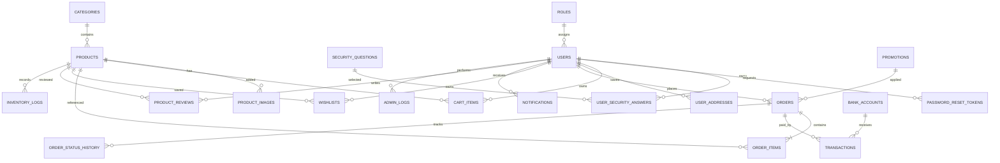

### 2.5. Nhóm bảng theo chức năng

| Nhóm | Bảng |
|---|---|
| Tài khoản & bảo mật | `roles`, `users`, `security_questions`, `user_security_answers`, `password_reset_tokens` |
| Danh mục & sản phẩm | `categories`, `products`, `product_images`, `product_reviews`, `wishlists` |
| Giỏ hàng & địa chỉ | `cart_items`, `user_addresses` |
| Đơn hàng & vận chuyển | `orders`, `order_items`, `order_status_history` |
| Thanh toán | `transactions`, `bank_accounts` |
| Marketing | `promotions`, `banners` |
| Vận hành & chăm sóc | `notifications`, `inventory_logs`, `admin_logs` |

---

## 3. Mô tả cấu trúc thư mục backend

```text
doan-back/
├── api/
│   └── index.js
├── src/
│   ├── config/
│   │   └── database.ts
│   ├── controllers/
│   │   ├── adminController.ts
│   │   ├── authController.ts
│   │   ├── cartController.ts
│   │   ├── orderController.ts
│   │   ├── paymentController.ts
│   │   ├── productController.ts
│   │   └── userController.ts
│   ├── middleware/
│   │   ├── auth.ts
│   │   └── upload.ts
│   ├── routes/
│   │   ├── index.ts
│   │   ├── auth.ts
│   │   ├── products.ts
│   │   ├── categories.ts
│   │   ├── banners.ts
│   │   ├── promotions.ts
│   │   ├── cart.ts
│   │   ├── orders.ts
│   │   ├── users.ts
│   │   ├── payment.ts
│   │   ├── upload.ts
│   │   ├── admin.ts
│   │   └── ai.ts
│   ├── types/
│   │   └── index.ts
│   ├── utils/
│   │   ├── supportStore.ts
│   │   └── vietqr.ts
│   ├── client/
│   └── server.ts
├── public/
├── supabase/
├── package.json
└── README.md
```

### 3.1. Bảng mô tả các file/thư mục

| File/thư mục | Vai trò | Mô tả |
|---|---|---|
| `src/server.ts` | Khởi động server | Khởi tạo Express, middleware bảo mật, static files, mount API router và health check |
| `src/config/database.ts` | Kết nối dữ liệu | Tạo Supabase client, chuyển đổi truy vấn SQL và gọi RPC `execute_sql` |
| `src/routes/index.ts` | Router trung tâm | Gom các router con và phân nhánh theo module |
| `src/routes/auth.ts` | Router xác thực | Đăng ký, đăng nhập, lấy tài khoản hiện tại, câu hỏi bảo mật, khôi phục/đổi mật khẩu |
| `src/routes/products.ts` | Router sản phẩm | Danh sách, chi tiết, đánh giá và các thao tác quản trị sản phẩm |
| `src/routes/categories.ts` | Router danh mục | Xem danh mục, chi tiết, tạo/sửa/xóa danh mục |
| `src/routes/banners.ts` | Router banner | Lấy banner công khai và CRUD banner quản trị |
| `src/routes/promotions.ts` | Router khuyến mãi | Xem khuyến mãi công khai, kiểm tra mã và CRUD mã giảm giá |
| `src/routes/cart.ts` | Router giỏ hàng | Lấy giỏ, thêm, sửa số lượng, xóa dòng và xóa giỏ |
| `src/routes/orders.ts` | Router đơn hàng | Tạo đơn, xem đơn của khách, theo dõi, hủy và thao tác đơn của nhân viên |
| `src/routes/users.ts` | Router tài khoản | Hồ sơ, địa chỉ, yêu thích, thông báo và quản lý tài khoản |
| `src/routes/payment.ts` | Router thanh toán | Lấy thông tin QR, xử lý Visa và xác nhận chuyển khoản QR |
| `src/routes/upload.ts` | Router tải tệp | Nhận ảnh đơn/lô và trả về data URL |
| `src/routes/admin.ts` | Router quản trị | Dashboard, giao dịch, nhật ký, sản phẩm, đơn hàng, người dùng, banner, tài khoản ngân hàng |
| `src/routes/ai.ts` | Router trợ lý | Chat với trợ lý AI/fallback và hội thoại hỗ trợ |
| `src/controllers/authController.ts` | Xử lý xác thực | Chứa nghiệp vụ đăng ký, đăng nhập, xác minh câu hỏi, đặt lại và đổi mật khẩu |
| `src/controllers/productController.ts` | Xử lý sản phẩm | Truy vấn danh sách/chi tiết, đánh giá, CRUD sản phẩm và cập nhật tồn kho |
| `src/controllers/cartController.ts` | Xử lý giỏ hàng | Thêm/sửa/xóa sản phẩm trong giỏ |
| `src/controllers/orderController.ts` | Xử lý đơn hàng | Tạo đơn, tính tiền, cập nhật tồn kho, hủy đơn, trạng thái và xác minh thanh toán |
| `src/controllers/paymentController.ts` | Xử lý thanh toán | Chuẩn bị QR, xác nhận QR và xử lý luồng Visa |
| `src/controllers/userController.ts` | Xử lý người dùng | Hồ sơ, địa chỉ, yêu thích, thông báo và quản trị người dùng |
| `src/controllers/adminController.ts` | Xử lý quản trị | Dashboard, banner, giao dịch, log, ngân hàng và khuyến mãi |
| `src/middleware/auth.ts` | Bảo vệ API | Xác thực JWT và kiểm tra vai trò/quyền |
| `src/middleware/upload.ts` | Upload middleware | Cấu hình Multer nhận ảnh |
| `src/types/index.ts` | Kiểu dữ liệu | Khai báo interface User, Product, Order, Cart, Payment, Banner, Promotion và Role |
| `src/utils/vietqr.ts` | Tạo QR | Tạo thông tin/URL mã VietQR theo cấu hình ngân hàng |
| `src/utils/supportStore.ts` | Lưu hội thoại | Quản lý hội thoại hỗ trợ trong bộ nhớ tiến trình |
| `src/client/` | Client trong source | Mã giao diện React/Vite được lưu trong source |
| `public/` | Tài nguyên tĩnh | HTML, CSS, JavaScript, ảnh và các tài nguyên phục vụ website |
| `api/index.js` | Điểm vào serverless | Entry point API dùng khi triển khai Vercel |

### 3.2. Luồng xử lý request tổng quát

```mermaid
flowchart TD
    A[Trình duyệt / Frontend] --> B[HTTP Request]
    B --> C[src/server.ts]
    C --> D[Middleware: Helmet, CORS, JSON, Cookie, Logger]
    D --> E[/api]
    E --> F[src/routes/index.ts]
    F --> G{Chọn module}
    G --> H[Router con]
    H --> I{Có yêu cầu đăng nhập?}
    I -->|Có| J[authenticate JWT]
    I -->|Không| K[Controller]
    J --> L{Kiểm tra vai trò?}
    L -->|Đạt| K
    L -->|Không đạt| M[401 / 403]
    K --> N[Controller xử lý nghiệp vụ]
    N --> O[config/database.ts]
    O --> P[Supabase PostgreSQL]
    P --> N
    N --> Q[JSON Response]
    Q --> A
```

---

## 4. Mô tả các router và endpoint

> Các endpoint dưới đây được đọc từ các file router. Những route quản trị có thể tồn tại cả ở router chuyên biệt và router `/admin` để tương thích/điều hướng tập trung.

### 4.1. Auth — `/api/auth`

| Method | Endpoint | Chức năng | Quyền |
|---|---|---|---|
| POST | `/register` | Đăng ký tài khoản | Công khai |
| POST | `/login` | Đăng nhập | Công khai |
| GET | `/me` | Lấy thông tin người dùng hiện tại | Đăng nhập |
| GET | `/security-questions` | Lấy danh sách câu hỏi bảo mật | Công khai |
| POST | `/forgot-password` | Bắt đầu khôi phục mật khẩu | Công khai |
| POST | `/verify-security-answer` | Xác minh câu trả lời | Công khai |
| POST | `/reset-password` | Đặt mật khẩu mới | Có token/phiên khôi phục |
| POST | `/change-password` | Đổi mật khẩu | Đăng nhập |

### 4.2. Products — `/api/products`

| Method | Endpoint | Chức năng | Quyền |
|---|---|---|---|
| GET | `/` | Lấy danh sách sản phẩm | Công khai |
| GET | `/:slug` | Xem chi tiết sản phẩm theo slug | Công khai |
| POST | `/:id/reviews` | Gửi đánh giá sản phẩm | Đăng nhập |
| GET | `/admin/list` | Danh sách sản phẩm quản trị | Nhân viên |
| POST | `/admin/create` | Tạo sản phẩm | Admin |
| GET | `/admin/:id` | Chi tiết sản phẩm quản trị | Nhân viên |
| PUT | `/admin/:id` | Cập nhật sản phẩm | Admin |
| DELETE | `/admin/:id` | Xóa sản phẩm | Admin |
| PUT | `/admin/:id/stock` | Cập nhật tồn kho | Nhân viên |

### 4.3. Categories — `/api/categories`

| Method | Endpoint | Chức năng | Quyền |
|---|---|---|---|
| GET | `/` | Danh sách danh mục kèm số lượng sản phẩm | Công khai |
| GET | `/:slug` | Chi tiết danh mục | Công khai |
| POST | `/` | Tạo danh mục | Admin |
| PUT | `/:id` | Cập nhật danh mục | Admin |
| DELETE | `/:id` | Xóa danh mục nếu không còn sản phẩm hoạt động | Admin |

### 4.4. Cart — `/api/cart`

| Method | Endpoint | Chức năng | Quyền |
|---|---|---|---|
| GET | `/` | Xem giỏ hàng | Đăng nhập |
| POST | `/` | Thêm sản phẩm vào giỏ | Đăng nhập |
| PUT | `/:id` | Cập nhật số lượng dòng giỏ | Đăng nhập |
| DELETE | `/:id` | Xóa một sản phẩm khỏi giỏ | Đăng nhập |
| DELETE | `/` | Xóa toàn bộ giỏ | Đăng nhập |

### 4.5. Orders — `/api/orders`

| Method | Endpoint | Chức năng | Quyền |
|---|---|---|---|
| POST | `/` | Tạo đơn hàng | Đăng nhập |
| GET | `/` | Danh sách đơn của khách hiện tại | Đăng nhập |
| GET | `/:id` | Chi tiết đơn | Đăng nhập |
| GET | `/:id/tracking` | Theo dõi đơn | Đăng nhập |
| PUT | `/:id/cancel` | Khách hủy đơn | Đăng nhập |
| GET | `/admin/list` | Danh sách đơn quản trị | Nhân viên |
| PUT | `/admin/:id/status` | Cập nhật trạng thái đơn | Nhân viên |
| POST | `/admin/:id/verify-payment` | Xác minh thanh toán | Admin |

### 4.6. Users — `/api/users`

| Method | Endpoint | Chức năng | Quyền |
|---|---|---|---|
| GET | `/profile` | Xem hồ sơ | Đăng nhập |
| PUT | `/profile` | Cập nhật hồ sơ | Đăng nhập |
| GET | `/addresses` | Danh sách địa chỉ | Đăng nhập |
| POST | `/addresses` | Thêm địa chỉ | Đăng nhập |
| PUT | `/addresses/:id` | Sửa địa chỉ | Đăng nhập |
| DELETE | `/addresses/:id` | Xóa địa chỉ | Đăng nhập |
| GET | `/wishlist` | Danh sách yêu thích | Đăng nhập |
| POST | `/wishlist/:productId` | Thêm/bỏ yêu thích | Đăng nhập |
| DELETE | `/wishlist/:productId` | Bỏ yêu thích | Đăng nhập |
| GET | `/notifications` | Danh sách thông báo | Đăng nhập |
| PUT | `/notifications/read-all` | Đánh dấu đã đọc toàn bộ | Đăng nhập |
| GET | `/admin/users` | Danh sách tài khoản | Admin |
| PUT | `/admin/users/:id` | Cập nhật tài khoản | Admin |

### 4.7. Payment — `/api/payment`

| Method | Endpoint | Chức năng | Quyền |
|---|---|---|---|
| GET | `/qr-info/:orderId` | Lấy thông tin tạo QR cho đơn | Đăng nhập |
| POST | `/visa-process` | Xử lý thanh toán Visa | Đăng nhập |
| POST | `/confirm-qr` | Khách gửi yêu cầu xác nhận chuyển khoản QR | Đăng nhập |

### 4.8. Banners — `/api/banners`

| Method | Endpoint | Chức năng | Quyền |
|---|---|---|---|
| GET | `/` | Lấy banner công khai | Công khai |
| GET | `/public` | Lấy banner công khai | Công khai |
| GET | `/all` | Danh sách banner quản trị | Admin |
| POST | `/` | Tạo banner | Admin |
| PUT | `/:id` | Sửa banner | Admin |
| DELETE | `/:id` | Xóa banner | Admin |

### 4.9. Promotions — `/api/promotions`

| Method | Endpoint | Chức năng | Quyền |
|---|---|---|---|
| GET | `/public` | Danh sách khuyến mãi còn hiệu lực | Công khai |
| POST | `/validate` | Kiểm tra mã giảm giá | Đăng nhập |
| GET | `/` | Danh sách toàn bộ khuyến mãi | Admin |
| POST | `/` | Tạo khuyến mãi | Admin |
| PUT | `/:id` | Cập nhật khuyến mãi | Admin |
| DELETE | `/:id` | Xóa khuyến mãi | Admin |

### 4.10. Admin — `/api/admin`

| Method | Endpoint | Chức năng | Quyền |
|---|---|---|---|
| GET | `/dashboard` | Thống kê tổng quan | Nhân viên |
| GET | `/transactions` | Danh sách giao dịch | Nhân viên |
| GET | `/logs` | Nhật ký quản trị | Admin |
| GET | `/products` | Danh sách sản phẩm | Nhân viên |
| GET | `/products/:id` | Chi tiết sản phẩm | Nhân viên |
| POST | `/products` | Tạo sản phẩm | Admin |
| PUT | `/products/:id` | Sửa sản phẩm | Admin |
| DELETE | `/products/:id` | Xóa sản phẩm | Admin |
| PUT | `/products/:id/stock` | Cập nhật tồn kho | Nhân viên |
| GET | `/orders` | Danh sách đơn | Nhân viên |
| PUT | `/orders/:id/status` | Cập nhật trạng thái đơn | Nhân viên |
| POST | `/orders/:id/verify-payment` | Xác minh thanh toán | Admin |
| GET | `/users` | Danh sách người dùng | Admin |
| PUT | `/users/:id` | Cập nhật người dùng | Admin |
| GET/POST/PUT/DELETE | `/banners...` | CRUD banner | Admin |
| GET | `/bank-accounts` | Xem tài khoản ngân hàng | Đăng nhập |
| PUT | `/bank-accounts/:id` | Cập nhật tài khoản ngân hàng | Admin |

### 4.11. AI — `/api/ai`

| Method | Endpoint | Chức năng | Quyền |
|---|---|---|---|
| POST | `/chat` | Gửi tin nhắn/ảnh và nhận phản hồi trợ lý | Đăng nhập |
| GET | `/conversations` | Nhân viên xem danh sách hội thoại | Nhân viên bán hàng |
| GET | `/conversations/:id` | Xem chi tiết hội thoại | Chủ hội thoại hoặc nhân viên |
| POST | `/conversations/:id/messages` | Nhân viên gửi phản hồi | Nhân viên bán hàng |

**Ghi chú quan trọng:** `src/utils/supportStore.ts` lưu hội thoại trong bộ nhớ tiến trình. README cũng lưu ý cần bổ sung bảng lưu bền vững nếu cần giữ lịch sử lâu dài hoặc triển khai nhiều instance. Vì vậy hội thoại AI hiện chưa được xác nhận là lưu trong PostgreSQL.

### 4.12. Upload — `/api/upload`

| Method | Endpoint | Chức năng | Ghi chú |
|---|---|---|---|
| POST | `/single` | Tải một ảnh | Trả về data URL base64 |
| POST | `/multiple` | Tải tối đa 5 ảnh | Trả về danh sách data URL |
| GET | `/list` | Lấy danh sách media | Trên serverless trả mảng rỗng |
| DELETE | `/:filename` | Yêu cầu xóa tệp | Hiện trả phản hồi xử lý; không xóa file lưu bền vững |

Trong router upload hiện tại, các route không gọi `authenticate` trực tiếp dù file có import middleware; cần rà soát lại nếu yêu cầu chỉ người đăng nhập mới được upload.

---

## 5. Các luồng nghiệp vụ chính

### 5.1. Luồng đăng ký và đăng nhập

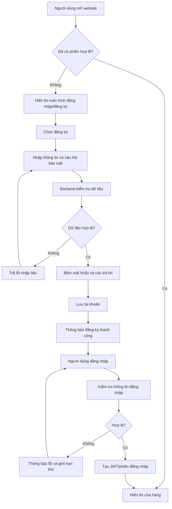

**Các file tham gia:**
- Giao diện: `src/client/` và `public/`.
- Router: `src/routes/auth.ts`.
- Nghiệp vụ: `src/controllers/authController.ts`.
- Bảo vệ API: `src/middleware/auth.ts`.
- Dữ liệu: `src/config/database.ts`.

### 5.2. Luồng quên và đặt lại mật khẩu

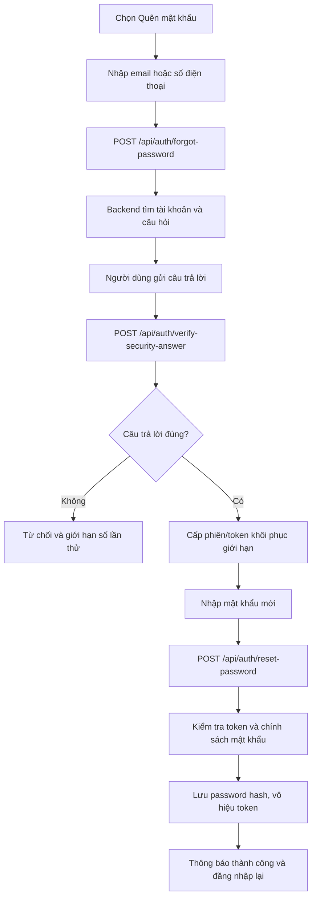

**File chính:** `src/routes/auth.ts`, `src/controllers/authController.ts`.

**Bảng liên quan:** `users`, `security_questions`, `user_security_answers`, `password_reset_tokens`.

### 5.3. Luồng tìm kiếm sản phẩm và thêm vào giỏ hàng

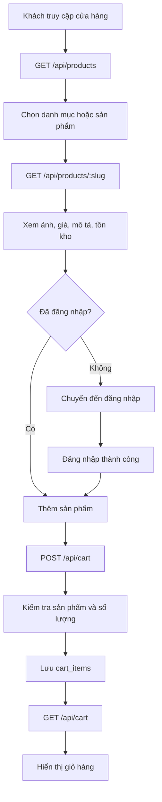

**File tham gia:** `routes/products.ts`, `routes/categories.ts`, `routes/cart.ts`, `controllers/productController.ts`, `controllers/cartController.ts`.

**Bảng liên quan:** `categories`, `products`, `product_images`, `cart_items`, `users`.

### 5.4. Luồng đặt hàng

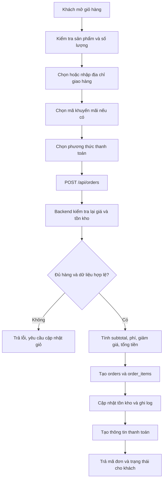

**File chính:** `src/routes/orders.ts`, `src/controllers/orderController.ts`.

**Bảng liên quan:** `users`, `cart_items`, `user_addresses`, `promotions`, `orders`, `order_items`, `products`, `inventory_logs`, `transactions`.

### 5.5. Luồng thanh toán COD

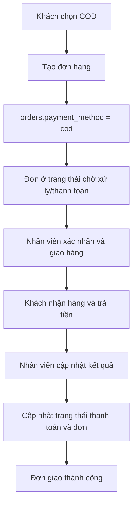

COD được khai báo là một giá trị của `PaymentMethod` trong `src/types/index.ts`. Chi tiết quy tắc cập nhật trạng thái cần đối chiếu logic trong `orderController.ts`.

### 5.6. Luồng thanh toán VietQR

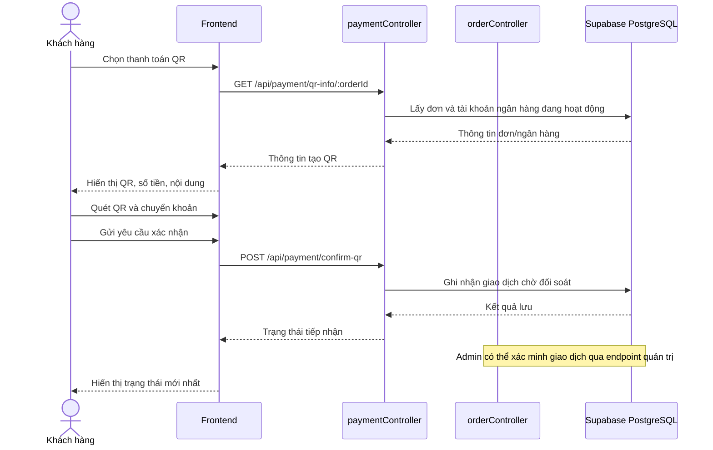

**Các file:** `routes/payment.ts`, `controllers/paymentController.ts`, `controllers/orderController.ts`, `utils/vietqr.ts`.

**Bảng:** `orders`, `transactions`, `bank_accounts`, `order_status_history`.

**Quy tắc quan trọng theo README:** QR được tạo từ cấu hình ngân hàng phía server; khách gửi yêu cầu đối soát, admin mới xác nhận đã nhận tiền. Không được tự động đánh dấu đã thanh toán chỉ vì khách mở hoặc gửi ảnh QR.

### 5.7. Luồng thanh toán Visa

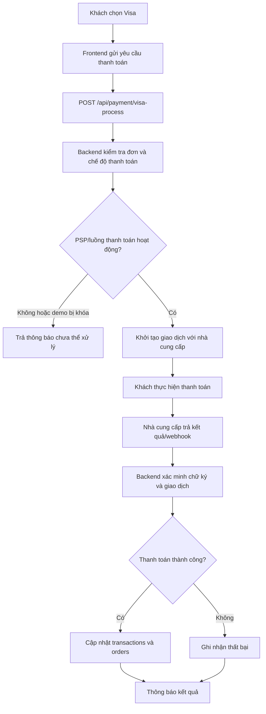

**Lưu ý:** README nêu endpoint mô phỏng Visa bị khóa mặc định (`PAYMENT_DEMO_MODE=false`); triển khai thật cần PSP và xác minh webhook/chữ ký. Không nên mô tả đây là cổng Visa production đã hoàn thiện.

### 5.8. Luồng nhân viên xử lý đơn hàng

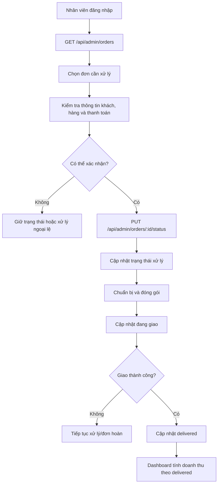

**File chính:** `src/routes/admin.ts`, `src/routes/orders.ts`, `src/controllers/orderController.ts`, `src/controllers/adminController.ts`.

### 5.9. Luồng hủy đơn và hoàn kho

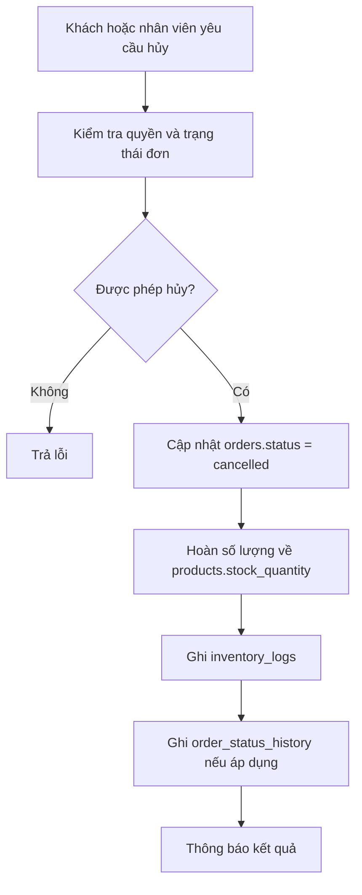

Ghi chú dự án xác nhận việc hủy đơn phải hoàn tồn kho và ghi `inventory_logs`.

### 5.10. Luồng tư vấn AI và hỗ trợ nhân viên

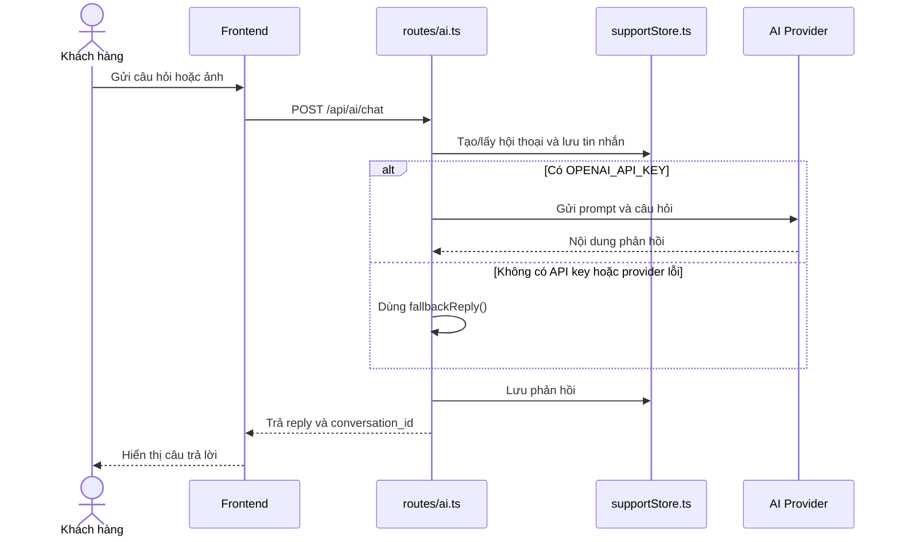

Nhân viên bán hàng có thể xem hội thoại qua `GET /api/ai/conversations` và phản hồi qua `POST /api/ai/conversations/:id/messages`. Hội thoại hiện lưu trong bộ nhớ tiến trình, không phải bảng PostgreSQL bền vững.

---

## 6. Luồng file/router tổng hợp

### 6.1. Sơ đồ các router chính

```mermaid
flowchart TB
    SERVER[src/server.ts] --> API[/api]
    API --> ROOT[src/routes/index.ts]
    ROOT --> AUTH[routes/auth.ts]
    ROOT --> PRODUCTS[routes/products.ts]
    ROOT --> CATEGORIES[routes/categories.ts]
    ROOT --> BANNERS[routes/banners.ts]
    ROOT --> PROMO[routes/promotions.ts]
    ROOT --> CART[routes/cart.ts]
    ROOT --> ORDERS[routes/orders.ts]
    ROOT --> USERS[routes/users.ts]
    ROOT --> PAYMENT[routes/payment.ts]
    ROOT --> UPLOAD[routes/upload.ts]
    ROOT --> ADMIN[routes/admin.ts]
    ROOT --> AI[routes/ai.ts]

    AUTH --> AUTHC[authController.ts]
    PRODUCTS --> PRODUCTC[productController.ts]
    CATEGORIES --> PRODUCTC
    CART --> CARTC[cartController.ts]
    ORDERS --> ORDERC[orderController.ts]
    PAYMENT --> PAYMENTC[paymentController.ts]
    USERS --> USERC[userController.ts]
    BANNERS --> ADMINC[adminController.ts]
    PROMO --> ADMINC
    ADMIN --> ADMINC
    ADMIN --> PRODUCTC
    ADMIN --> ORDERC
    ADMIN --> USERC

    AUTHC --> DB[config/database.ts]
    PRODUCTC --> DB
    CARTC --> DB
    ORDERC --> DB
    PAYMENTC --> DB
    USERC --> DB
    ADMINC --> DB
    DB --> SUPA[(Supabase PostgreSQL)]
    AI --> STORE[supportStore.ts - In-memory]
```

### 6.2. Quy tắc phân luồng quyền

| Nhóm API | Middleware thường dùng | Ý nghĩa |
|---|---|---|
| Public | Không yêu cầu JWT | Đăng nhập, đăng ký, xem sản phẩm/danh mục/banner công khai |
| Customer | `authenticate` | Bắt buộc có JWT hợp lệ |
| Staff | `authenticate`, `requireStaff` hoặc `requireRole(2)` | Nhân viên được phép xử lý nghiệp vụ tương ứng |
| Admin | `authenticate`, `requireAdmin` | Chỉ quản trị viên được thực hiện thao tác nhạy cảm |

**Lưu ý rà soát:** Upload endpoints hiện không gắn `authenticate` trong phần route; cần xác định có chủ đích cho phép upload công khai hay cần bảo vệ. Các endpoint AI yêu cầu đăng nhập. Phân quyền thực tế phải căn cứ middleware và route, không chỉ căn cứ tên trang giao diện.

---

## 7. Quy tắc nghiệp vụ và trạng thái dữ liệu

### 7.1. Trạng thái đơn hàng

Các giá trị type trong `src/types/index.ts`:

| Giá trị | Diễn giải |
|---|---|
| `pending` | Chờ xác nhận |
| `confirmed` | Đã xác nhận |
| `processing` | Đang xử lý |
| `shipping` | Đang giao |
| `delivered` | Đã giao thành công |
| `cancelled` | Đã hủy |
| `returned` | Đã hoàn/hoàn trả |

### 7.2. Trạng thái thanh toán

| Giá trị | Diễn giải |
|---|---|
| `pending` | Chờ thanh toán |
| `paid` | Đã thanh toán |
| `failed` | Thanh toán thất bại |
| `refunded` | Đã hoàn tiền |

### 7.3. Phương thức thanh toán

| Giá trị | Diễn giải |
|---|---|
| `cod` | Tiền mặt khi nhận hàng |
| `qr_transfer` | Chuyển khoản VietQR |
| `visa` | Thẻ Visa |

### 7.4. Nguyên tắc tồn kho và doanh thu

- Backend cần kiểm tra lại giá và tồn kho ở thời điểm tạo đơn, không tin giá do trình duyệt gửi lên.
- Khi hủy đơn, hoàn số lượng về kho và ghi log.
- Dashboard chỉ tính doanh thu từ đơn có trạng thái `delivered`, theo ghi chú dự án.
- Giao dịch QR cần đối soát; không coi thao tác gửi yêu cầu xác nhận từ khách là bằng chứng tiền đã vào tài khoản.
- Visa production cần tích hợp PSP và xác minh callback/webhook.

---

## 8. Các điểm cần kiểm tra/bổ sung trước khi chốt tài liệu database

1. Bổ sung file migration SQL thật của Supabase để xác nhận chính xác cấu trúc cột, kiểu dữ liệu, PK, FK, unique, check constraint và index.
2. Kiểm tra sự thống nhất giữa tên cột trong `src/types/index.ts`, SQL trong controller và schema PostgreSQL (ví dụ `role_id`/`role`, `order_number`/`order_code`).
3. Xác nhận bảng `password_reset_tokens`, `inventory_logs`, `order_status_history`, `admin_logs` có đủ cột và ràng buộc như logic đang sử dụng.
4. Xác nhận `product_reviews` là tên bảng thống nhất. Ghi chú dự án đã nêu việc chuẩn hóa từ `reviews` sang `product_reviews`.
5. Bổ sung lưu trữ hội thoại AI vào PostgreSQL nếu cần giữ lịch sử sau khi server khởi động lại hoặc chạy nhiều instance.
6. Rà soát xác thực cho các endpoint upload.
7. Kiểm tra việc xử lý lỗi và giao dịch nguyên tử khi tạo đơn, trừ kho, hủy đơn và hoàn kho.
8. Không đưa `.env`, service role key, JWT secret, mật khẩu tài khoản mẫu hoặc thông tin ngân hàng thật vào báo cáo công khai.

---

## 9. Kết luận

Backend WoodHome được tổ chức theo kiến trúc Express có router trung tâm, các module nghiệp vụ tách biệt và controller xử lý logic. Các nhóm chức năng chính gồm xác thực, danh mục/sản phẩm, giỏ hàng, đơn hàng, thanh toán, người dùng, quản trị và trợ lý AI. Dữ liệu nghiệp vụ chính được truy cập thông qua adapter Supabase PostgreSQL.

Tài liệu này cung cấp bảng mô tả dữ liệu, mô tả file, danh sách endpoint và sơ đồ các luồng nghiệp vụ để sử dụng trong báo cáo đồ án. Phần mô hình bảng là bản tổng hợp logic từ mã nguồn và PRD; cần file migration/schema thực tế để xác nhận hoàn toàn cấu trúc vật lý của database.

---

## 10. Nguồn đối chiếu trong archive

- `README.md` — mô tả công nghệ, database, chức năng, cài đặt và triển khai.
- `PRD - backend nâng cao.docx` — đặc tả yêu cầu và mô hình thực thể, mục 13; luồng nghiệp vụ, mục 16.
- `WoodHome_ việc cần làm để web chạy trơn tru.md` — ghi chú hoàn thiện router, tồn kho, audit logs và Dashboard.
- `src/config/database.ts` — adapter Supabase PostgreSQL.
- `src/types/index.ts` — kiểu dữ liệu và enum.
- `src/server.ts` — khởi tạo Express và mount router.
- `src/routes/*.ts` — endpoint và phân quyền.
- `src/controllers/*.ts` — truy vấn và xử lý nghiệp vụ.
- `src/utils/supportStore.ts` — lưu hội thoại hỗ trợ trong bộ nhớ.
